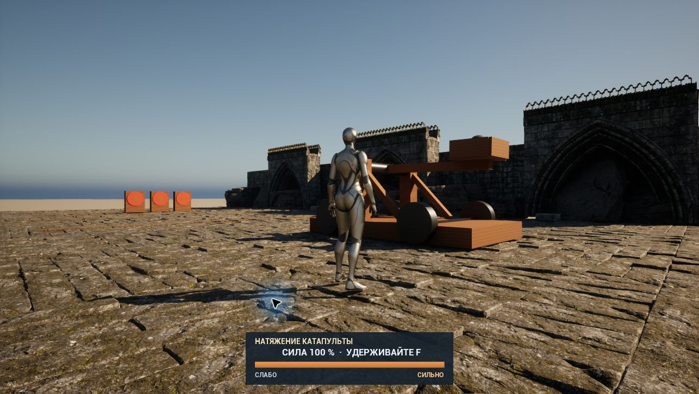

# Натяжение катапульты и оформление

## Управление

- **Удерживайте F**: шкала растёт от 20% до 100% примерно за 2 секунды.
- **Отпустите F**: выполняется один бросок с выбранной силой.
- Короткое нажатие даёт минимальную силу. После достижения 100% катапульта ждёт отпускания клавиши.
- Во время автоматической перезарядки повторные нажатия игнорируются.

Физический фиксатор удерживает ядро до угла 35°, затем освобождает его без приложения импульса. Заряд изменяет жёсткость углового привода `Physics Constraint Component`; снаряд получает движение только от контакта с ложкой. Импульс, ProjectileMovement и принудительное задание скорости снаряда не используются. `FullChargeSeconds` и `MinCharge` доступны в настройках экземпляра. UMG-панель показывает процент, состояние и границы «СЛАБО / СИЛЬНО»; она не перехватывает управление персонажем.

## Внешний вид

Основная публичная карта `L_Catapult` получила собственные материалы дерева, железа и латуни, декоративные колёса и подпорки, а также круговые мишени. Рабочая физическая ложка, основной шарнир и коллизии механизма сохранены; добавлен отдельный физический фиксатор ядра для одинакового угла освобождения.

Дополнительная **локальная** карта `L_Catapult_Ruins` использует имеющиеся у владельца наборы Fab:

- [Environment — Rock Collection 04](https://www.fab.com/listings/a51e61ac-98fa-4c54-ab23-fc533687afb7), Shadowmire Studios — скалы по краям полигона.
- [Abandoned Cathedral](https://www.fab.com/listings/65a30aeb-8d8f-41c7-af2b-b1bc3db929c3), RagTarock — каменная кладка, арки, стены и обломки.

Фон дополнен землёй, мягкой дымкой и тёплым освещением. Декор не имеет коллизий; под визуальным каменным настилом остаётся исходная игровая поверхность.

Исходники этих наборов и локальная карта исключены из публичного Git. [Fab Standard License](https://www.fab.com/eula) допускает использование в проектах и передачу исходных ресурсов работающим над проектом соавторам с закрытым доступом. Публичная карта запускается без Fab-пакетов.

Для восстановления локальной версии из собственной лицензированной копии: `prepare_catapult_fab.restore(source_content_path)`, затем `style_catapult.fab_scene()` в инструментах редактора. Файлы исходной игры не изменяются.

## Проверка

Проверены три уровня мощности, рост и ограничение шкалы, отсутствие выстрела до отпускания, защита перезарядки от повторных команд, возврат ложки и появление следующего ядра. Короткое нажатие F дополнительно проверено через настоящее окно игры и даёт ровно 20%.

Дальность измеряется до первого касания земли: дальнейшее прокатывание и отскоки не являются дальностью полёта. [Отчёт проверки](CatapultChargeValidation.json).

Основная карта: 49 проверок физического цикла и 36 проверок заряда пройдены. Локальная карта Fab: 35 проверок пройдены, настоящее короткое нажатие F подтверждено. Публичная карта не содержит ссылок на исходники Fab-паков.
