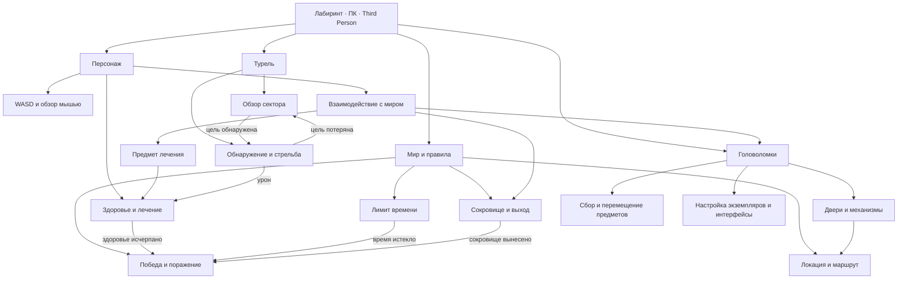

# 11.2 — Начало создания игры «Лабиринт»

Этап урока: разбор концепта, выделение сущностей и механик, порядок последующей реализации. Это проектирование; перечисленные ниже будущие системы пока не объявляются реализованными.

Источник: [урок 11.2 Skillbox](https://go.skillbox.ru/profession/profession-unreal-engine-5-game-developer-from-scratch/game-stels-shuter/videolesson/6f965bb4-a2a4-4a46-9b0d-129ce9a00e33) и приложенные к нему конспект «Начало создания игры» и «Концепт». Учебные PDF и иллюстрации остаются вне публичного репозитория. Диаграмма ниже — собственная декомпозиция для этого проекта.

## Концепт и цели

Игра для ПК с видом от третьего лица; управление WASD и мышью. Игрок исследует лабиринт, находит сокровище и выносит его до окончания времени. Основной ритм — исследование и небольшие разнообразные головоломки. Турели создают опасные участки, встречаясь реже головоломок.

| Горизонт цели | Действия игрока | Следствие для проектирования |
| --- | --- | --- |
| Краткосрочный | Осмотреть участок, решить небольшую головоломку | Читаемые ориентиры, понятные интерактивные объекты |
| Среднесрочный | Пройти опасный участок, избежать турели или ловушки | Укрытия, видимая зона угрозы, возможность обхода |
| Долгосрочный | Найти сокровище и выход | Связный маршрут, фиксация получения сокровища и завершения игры |

## Схема сущностей и механик

Схема описывает функциональные части, а не иерархию акторов на сцене. Двери, сокровище и предмет лечения выделены как предлагаемые точки взаимодействия; это ещё не созданные Blueprint-ассеты.

## Ответственность и связи

| Сущность | Отвечает за | Получает / сообщает | Как проверить при реализации |
| --- | --- | --- | --- |
| Персонаж | Перемещение, обзор, попытку взаимодействия | Ввод игрока; ссылку на доступный объект | WASD и мышь работают; действие доступно только для подходящего объекта |
| Здоровье | Текущее здоровье, урон, лечение | Урон от опасности; лечение от предмета; событие смерти | Лечение ограничено максимумом; нулевое здоровье фиксирует поражение один раз |
| Мир / игровая сессия | Время, состояние прохождения, результат | Смерть, истечение времени, успешный выход | Повторные события не меняют уже завершённый результат |
| Сокровище / выход | Получение цели и проверку её выноса | Взаимодействие игрока; сообщение об успешном выходе | Выход без сокровища не засчитывается; выход с ним даёт победу до завершения времени |
| Головоломка | Условие решения и состояние механизма | Действия через интерфейс; уведомление двери или другого объекта | Решение меняет только связанную группу; повторное действие безопасно |
| Турель | Обзор сектора, поиск цели, атаку | Позицию и видимость персонажа; сообщение об уроне | Переходы обзор ↔ атака; укрытие блокирует попадание; параметры редактируются |
| Локация | Пространство исследования, укрытия, размещение объектов | Состав и настройки экземпляров | Есть проходимый путь, читаемые интерактивные объекты и обход угроз |

Это предложенные границы ответственности. Конкретные имена новых классов, значения здоровья, длительность раунда и параметры урона следует определить в соответствующих следующих уроках, а не выдавать за требования 11.2.

## Что уже есть в StealthShooter

| Основа | Подтверждённый статус | Возможное использование далее |
| --- | --- | --- |
| ThirdPerson Template | Исходные персонаж, управление и GameMode сохранены | Отдельные классы игры на основе шаблона без изменения старых карт |
| BPI_Switchable, кнопка и подписки светильников | Реализованы в 3.8, оформлены в 5.4 | Пример слабого связывания интерактивных объектов |
| Групповой пульт и UMG | Реализованы в 4.4 | Пример контекстного интерфейса и настройки экземпляров |
| Навигационный актор | Реализован в 10.7 | Пример движения по NavMesh; не готовый преследующий противник |
| Здоровье, сокровище, завершение раунда, игровые турели | Не реализованы в этом проекте | Следующие этапы модуля |

Примеры предыдущих практических сохраняются отдельно. Схема не предполагает их автоматического включения в игровую локацию.

## Порядок последующей реализации

1. Подготовить персонажа игры на основе ThirdPerson Template.
2. По следующим урокам добавить ему перемещение, здоровье и взаимодействие.
3. Определить правила мира: время, получение сокровища, выход, победу и поражение.
4. Создать настраиваемые головоломки и связать их с интерактивными объектами.
5. Создать турель с состояниями обзора и атаки, проверкой видимости и уроном.
6. Собрать игровую локацию из доступных ресурсов, проверить полный маршрут и условия завершения.

Статические ловушки и преследующий противник присутствуют в общем концепте. Их не следует добавлять автоматически в рамках вводной декомпозиции: обязательный объём уточняется в соответствующих заданиях. В доступном PDF цветовые выделения из видео не различимы; основной набор этой схемы опирается на явно перечисленные шаги конспекта 11.2.

## Результат этого урока

Подготовлены схема систем, распределение ответственности, связи, критерии будущих проверок и порядок реализации. Игровые ассеты, настройки запуска и предыдущие отчёты не изменяются. Регрессионная проверка в настоящем Play фиксируется отдельно в `Lesson112PlayValidation.json`.

Следующий урок — [11.3 «Создание проекта и персонажа»](https://go.skillbox.ru/profession/profession-unreal-engine-5-game-developer-from-scratch/game-stels-shuter/videolesson/e870e475-59c4-4706-91c3-2de8fc7eb568). Он будет выполняться в существующем StealthShooter с отдельными игровыми классами, сохраняя примеры прошлых практических.
