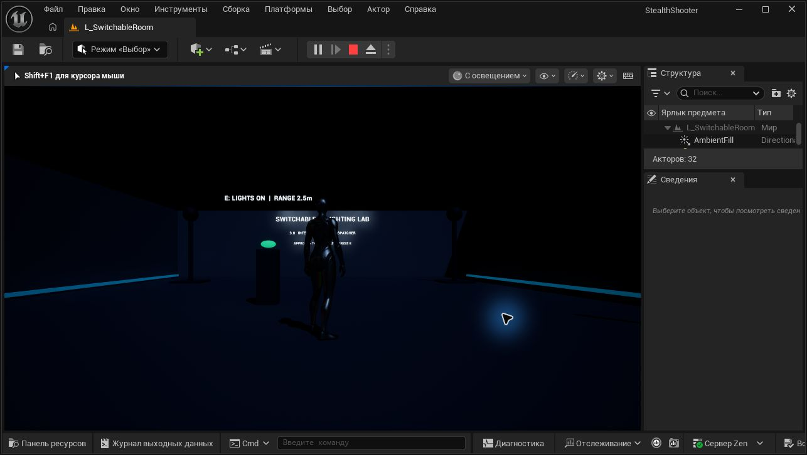

# Практическая 3.8 — переключение светильников

Карта: `/Game/StealthShooter/Maps/L_SwitchableRoom`. Проект уже включает Third Person Template: используются существующие персонаж, ввод движения и GameMode. Новые классы расположены в `Content/StealthShooter/Interaction`.

## Соответствие заданию

| Требование | Реализация |
| --- | --- |
| Third Person Template | Исходные BP_ThirdPersonCharacter и BP_ThirdPersonGameMode используются без изменений |
| Интерфейс включения и выключения | BPI_Switchable: SwitchOn, SwitchOff, IsSwitchOn |
| Светильник реализует интерфейс | BP_SwitchableLamp управляет настоящим Point Light и материалом колбы |
| Кнопка реализует интерфейс | BP_LightSwitch хранит состояние и реализует SwitchOn / SwitchOff / IsSwitchOn |
| Диспетчер кнопки | OnSwitched передаёт булевый Enabled только при изменении состояния |
| Каждый светильник подписывается сам | BindToButton в Begin Play, собственный OnSwitchChanged и UnbindFromButton в End Play |
| E в определённом радиусе | TryInteract получает локального игрока, проверяет ссылку и расстояние ≤ InteractionRadius (250 см) |
| Стиль, комментарии, .gitignore | Префиксы BPI_/BP_/M_/L_, комментарии в графах, временные папки исключены |

## Управление

Нажмите Play, подойдите к консоли и нажмите E. Один раз — выключить, ещё раз — включить. Вне радиуса нажатие ничего не меняет. WASD, мышь и прыжок работают как в исходном Third Person Template. Esc завершает Play In Editor.

Каждый экземпляр светильника ссылается на общую кнопку через ControlButton. Кнопка не хранит массив светильников и не вызывает их напрямую: она оповещает подписчиков. Для подписки используется функция с той же сигнатурой, что у диспетчера; обработчик вызывает интерфейсное сообщение самому светильнику. При подписке лампа сразу синхронизируется с состоянием кнопки. Повторная подписка защищена bBound, а выключение и включение кнопки идемпотентны.

Радиус измеряется в трёхмерном пространстве между позициями акторов; граница включена. Проверка выполняется по нажатию, без Tick и без смены системы ввода исходного персонажа. ControlButton и InteractionRadius можно настроить перед Play. Подпись 2,5 м соответствует исходному значению радиуса.

Светлый и тёмный режимы используют реальную видимость Point Light. Материал колбы показывает состояние, а материал текста не зависит от освещения, поэтому подсказка доступна и в темноте. Для комнаты использованы встроенные геометрические формы и материалы, созданные средствами редактора.

## Проверки

[Отчёт Play In Editor](SwitchableRoomValidation.json) содержит проверки интерфейсов, видимости четырёх Point Light, материалов, допустимого и недопустимого расстояния, точной границы, многократных переключений, идемпотентности и отсутствия дублирующихся подписок. Проверены отключение одного подписчика, его повторная синхронизация, отсутствующая ссылка на кнопку и уничтожение подписчика во время Play. Физическая клавиша E проверена отдельно в игровом окне вне радиуса и рядом с кнопкой.

`validate_switchable_room.run()` запускается во время Play на этой карте. `run_lifecycle()` проверяет потерю ссылки и уничтожает один экземпляр только в игровом мире; после него перезапустите Play для восстановления всех четырёх ламп. Скрипты не меняют сохранённую карту во время проверок.

Для редактирования средствами Python используется `Tools/OpenStealthEditor.ps1 -WithTools`. При повторном построении через build_switchable_room после prepare добавьте BPI_Switchable через Class Settings к BP_LightSwitch и BP_SwitchableLamp. Затем выполняются appearance, button_graphs, lamp_graphs, level, comments и readable_text. Для обычного открытия готового проекта эти действия не нужны.

## Материалы

- [Требования практической 3.8](https://go.skillbox.ru/profession/profession-unreal-engine-5-game-developer-from-scratch/game-stels-shuter/homework/75e757c0-2a59-4e1a-b99c-c4396a74ded0)
- [Диспетчеры событий](https://go.skillbox.ru/profession/profession-unreal-engine-5-game-developer-from-scratch/game-stels-shuter/longread/9d172815-72a7-4ca5-b53f-c3bcec307c8e)
- [Интерфейсы](https://go.skillbox.ru/profession/profession-unreal-engine-5-game-developer-from-scratch/game-stels-shuter/videolesson/5c516ac3-abf9-4825-bf93-b9cda75b4e23)

Сохранённые карты и материалы предыдущих практических работ доступны в проекте. Файлы курса в репозиторий не копируются.
