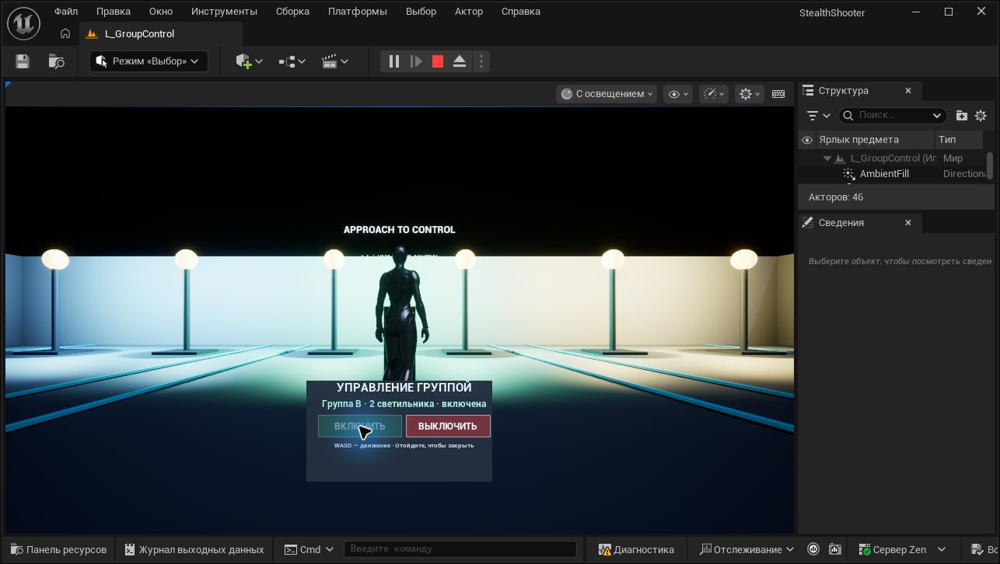

# Практическая 4.4 — группы объектов и UMG

Карта: `/Game/StealthShooter/Maps/L_GroupControl`. Используется существующий Third Person Template. Исходный персонаж, его движение и предыдущие карты не изменены.

## Соответствие заданию

| Требование | Реализация |
| --- | --- |
| ThirdPerson Template | Существующие BP_ThirdPersonCharacter и BP_ThirdPersonGameMode |
| Интерфейс включения/выключения | Общий BPI_Switchable из практической 3.8: SwitchOn, SwitchOff, IsSwitchOn |
| Кнопка с массивом объектов | BP_GroupSwitch реализует интерфейс, обходит SwitchTargets и посылает сообщения каждому допустимому объекту |
| Настройка на сцене | SwitchTargets — Array of Actor, Instance Editable; GroupLabel и InteractionRadius также доступны в экземпляре |
| Несколько независимых групп | Три пульта A/B/C, по два светильника у каждого |
| Виджет при приближении | WBP_GroupSwitch добавляется во viewport внутри радиуса 250 см и удаляется при выходе |
| Включение и выключение в виджете | Две кнопки UMG, текущий статус, блокировка уже выполненного действия |
| Именование и комментарии | BP_/WBP_/BPI_/L_, поясняющие комментарии в графах, существующий .gitignore |

## Просмотр

Откройте проект в Unreal Engine 5.8.3 и нажмите Play на стартовой карте L_GroupControl. Подойдите к центральному пульту; для других групп двигайтесь влево или вправо вдоль ряда. В появившейся панели нажимайте «ВКЛЮЧИТЬ» и «ВЫКЛЮЧИТЬ». WASD и прыжок доступны при открытом интерфейсе. Отойдите от пульта, чтобы панель закрылась и курсор скрылся.

## Устройство

Новые ресурсы: `Content/StealthShooter/GroupControl/BP_GroupSwitch`, `Content/StealthShooter/UI/WBP_GroupSwitch` и отдельная карта L_GroupControl. Пульт использует сохранённый интерфейс и светильники из 3.8. В этой работе управление идёт через массив экземпляра, а не через подписки на диспетчер. Каждый пульт хранит собственный виджет, который повторно используется при приближении.

Проверка радиуса выполняется таймером раз в 0,1 секунды. Расстояние трёхмерное, между позициями акторов, граница 250 см включена. Виджет создаётся при Begin Play, но появляется только рядом с пультом. Области трёх пультов на карте не пересекаются. При изменении расположения или радиуса сохраняйте это условие, чтобы показывалась одна панель.

ShowControls устанавливает Game and UI и показывает курсор; HideControls удаляет панель и возвращает Game Only. Кнопки UMG не забирают клавиатурный фокус. Обработчики HandleOn/HandleOff повторно проверяют ссылку и расстояние перед интерфейсным сообщением, поэтому сохранённая ссылка на скрытый виджет не позволяет управлять пультом издалека. RefreshDisplay обновляет подпись и доступность кнопок по событиям; привязок данных на каждый кадр нет.

Чтобы изменить группу, остановите Play, выделите её BP_GroupSwitch и измените массив SwitchTargets в Details. Добавляйте акторы, реализующие BPI_Switchable. Пустой массив и отсутствующая ссылка безопасно пропускаются. Название группы задаётся в GroupLabel. Радиус панели — InteractionRadius.

## Проверки

[Отчёт Play In Editor](GroupControlValidation.json): три группы, шесть светильников, интерфейс, принадлежность виджета, вход/выход/повторный вход, независимость групп, подпись и доступность кнопок, повторные циклы, пустой массив, отсутствующая ссылка и добавление объекта в массив. Отдельно проверены реальные клики «ВЫКЛЮЧИТЬ»/«ВКЛЮЧИТЬ», движение клавишей S при открытой панели и автоматическая реакция таймера после перемещения без прямого вызова UpdateProximity. Ошибок Blueprint Runtime / Accessed None при проверке не было.

`Tools/validate_group_control.py` запускается во время Play. Он меняет только игровой мир и восстанавливает включённые группы, исходные массивы и позицию игрока. Дополнительные проверки физического ввода и асинхронного таймера записаны в итоговом отчёте отдельно.

`Tools/build_group_control.py` — инструмент создания новых ресурсов для редактора, включённого через `Tools/OpenStealthEditor.ps1 -WithTools`. Для воссоздания макета сначала добавьте корневую Canvas Panel в Designer; StatusText должен быть отмечен Is Variable. ButtonOn и ButtonOff также являются переменными. Готовые бинарные ресурсы уже содержат макет, графы и комментарии; для просмотра инструменты не требуются.

## Материалы

- [UMG и виджеты Blueprint](https://go.skillbox.ru/profession/profession-unreal-engine-5-game-developer-from-scratch/game-stels-shuter/videolesson/24ac30a4-b5d4-4b66-bbd6-e4fe75543a7b)
- [Настройка](https://go.skillbox.ru/profession/profession-unreal-engine-5-game-developer-from-scratch/game-stels-shuter/videolesson/1588be48-6e06-48f0-895c-3656aa03099e)

Реализована только практическая 4.4. Учебные примеры главного меню, здоровья и очков не добавлялись. PDF и видео курса не включены в репозиторий.
