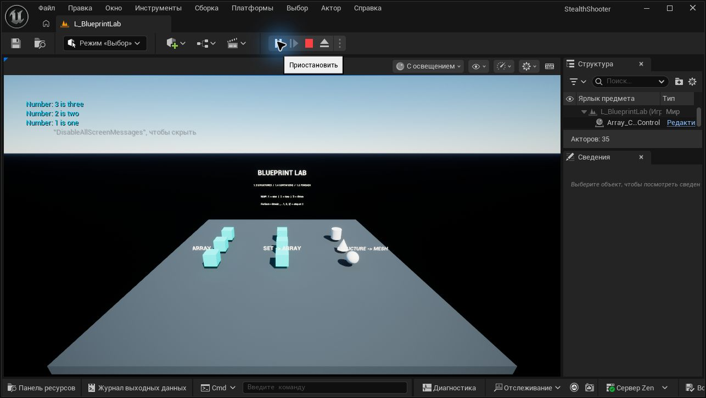

# Структуры, контейнеры и ForEach — 1.3–1.5

Учебная карта `/Game/StealthShooter/Maps/L_BlueprintLab` выполняет примеры при Begin Play. Проверено в Unreal Engine 5.8.3: 38 проверок в обычном Play In Editor, включая пустые контейнеры, отсутствующую ссылку и завершение цикла без найденного значения. [Результаты](Lessons13-15Validation.json).

## Примеры

- `S_Example`: Name, Description, Image, Cost. `BP_StructureExamples` создаёт Keycard с ценой 100, меняет только Cost на 75 через Set Members и читает поля через Break. Имя и описание сохраняются.
- `S_StaticObjInfo`: Name и Mesh. Три экземпляра `BP_StaticObject` получают Sphere, Cone и Cylinder из собственной структуры при запуске.
- `BP_ColorControl`: обходит массив ссылок или Set, преобразованный в Array, и меняет материал трёх кубов. Отсутствующие объекты пропускаются через Is Valid.
- `BP_ContainerExamples`: Array сохраняет порядок и повторения, Set выполняет Difference/Intersection/Union, Map связывает числа со строками и обходится через Keys и Find.
- ForEachLoopWithBreak обходит `[1, 1, 2, 3]` и прекращает работу на первом числе 2: обработано три элемента, выход Completed вызван.

Set и Map не используются как источник гарантированного порядка. Difference для `{1,2,3}` и `{1,2,4}` возвращает `{3}`. В установленной UE 5.8 повторное добавление 1 через Blueprint Add Unique возвращает −1 и не изменяет массив. У ForEachLoopWithBreak выход завершения называется Completed. При изменении копии структуры из массива результат нужно записать обратно в массив.

## Запуск и инструменты

Откройте `StealthShooter.uproject`, выберите карту L_BlueprintLab и нажмите Play. Инструментальные плагины для просмотра не нужны. `Tools/OpenStealthEditor.ps1 -WithTools` включает установленные средства редактирования; Python `validate_blueprint_lab.run()` запускается во время Play.

`build_blueprint_lab` содержит отдельные этапы prepare, objects, colors, containers, structures, level. Структуры создаются в редакторе с указанными выше полями до prepare. Если structures возвращает refresh_required, выполните в редакторе Blueprint File → Refresh All Nodes, затем structures_finish. Обычный просмотр готового проекта не требует повторного построения ресурсов.

## Материалы

- [1.3 Структуры](https://go.skillbox.ru/profession/profession-unreal-engine-5-game-developer-from-scratch/game-stels-shuter/longread/9b12f8b7-829b-4ff1-a171-4987a16ef610)
- [1.4 Контейнеры](https://go.skillbox.ru/profession/profession-unreal-engine-5-game-developer-from-scratch/game-stels-shuter/longread/e10e8e0a-b045-4e7b-8c92-4a18deb6d4c5)
- [1.5 Управление потоком исполнения ForEach](https://go.skillbox.ru/profession/profession-unreal-engine-5-game-developer-from-scratch/game-stels-shuter/videolesson/90db09dd-8a46-459e-8ba1-03da1bbdadbf)

Исходные тексты и PDF курса не распространяются в репозитории. Эта карта демонстрирует основы Blueprint; полноценная игровая логика стелс-шутера относится к следующим этапам курса.
