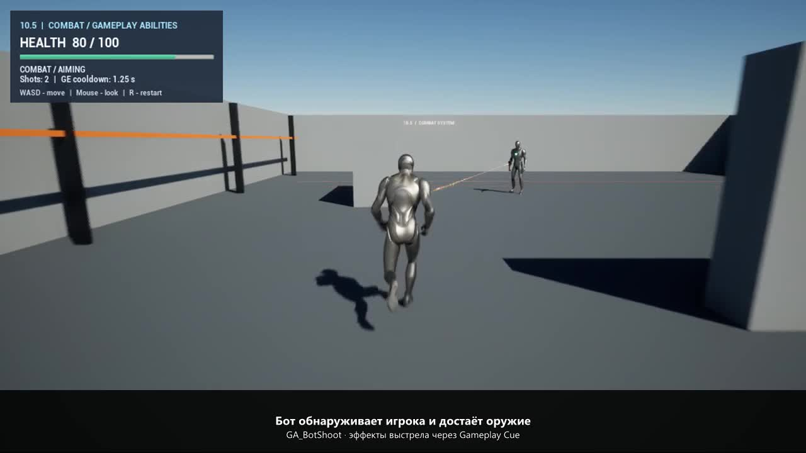

# Практическая 10.5 — стрельба бота на Gameplay Ability System

Карта: `/Game/StealthShooter/Maps/L_CombatGAS` в основном `StealthShooter.uproject`.

Исходник модуля «AI Режим боя» отсутствовал. Для этой работы подготовлена отдельная основа патрулирования и боя. Предыдущие карты и отдельный проект практической 9.6 не заменяются.

## Запуск

1. Установить Unreal Engine 5.8.4, Visual Studio 2022 Build Tools с MSVC v143 14.44, Windows SDK и .NET Framework SDK 4.8.
2. После клонирования выполнить `git lfs pull`. Сгенерировать файлы проекта и собрать `StealthShooterEditor` в конфигурации Development Editor / Win64. При первом открытии Unreal также предложит собрать модули.
3. Открыть `L_CombatGAS`, нажать Play и щёлкнуть по игровому окну.
4. WASD — передвижение, мышь — обзор, Space — прыжок, R — перезапуск карты.
5. В начале игрок находится за укрытием. Выйти сбоку: бот обнаружит игрока, достанет оружие, повернётся к цели и начнёт одиночный огонь. Вернуться за укрытие: стрельба прекращается; после короткого поиска бот убирает оружие и продолжает патруль.

Стартовая карта проекта оставлена прежней — для проверки этой работы нужно открыть `L_CombatGAS` вручную.

## Устройство

| Требование | Реализация |
| --- | --- |
| Здоровье в AttributeSet | `UCombatAttributeSet`: `Health`, `MaxHealth`, начальные значения 100. Ограничение диапазона в `PreAttributeChange` и `PostGameplayEffectExecute`. |
| Полоска здоровья | `WBP_CombatHUD` / `UCombatHUD`: UMG ProgressBar, подписки на изменения GAS-атрибутов. Нет отдельной переменной здоровья в виджете. |
| Стрельба через способность | `GA_BotShoot` / `UCombatShootAbility`: проверка цели, `CommitAbility`, трассировка, применение урона, завершение способности. |
| Визуальные эффекты | `GC_Bot_Shoot` / `UCombatShotCue`: вспышка, трассер и звук. Косметические объекты не имеют коллизии и не наносят урон. Явная ссылка из бота обеспечивает регистрацию Cue и включение в сборку. |
| Урон через Gameplay Effect | `GE_BotShotDamage`: мгновенный аддитивный модификатор Health −10. Накладывается на ASC игрока только при попадании. |
| Кулдаун через Gameplay Effect | `GE_BotShotCooldown`: длительность 1,25 с, выдаёт `Cooldown.Bot.Shoot`. Способность использует стандартный GAS cooldown/commit. Таймера одиночного огня нет. |
| Сохранение поведения боя | `BP_CombatBot` / `ACombatBot`: патруль по NavMesh, радиус и конус обзора, проверка видимости, доставание/убирание оружия, прицеливание, возвращение к патрулю. |

Для отладки можно использовать консольную команду `showdebug abilitysystem`. На демонстрационном HUD дополнительно показаны состояние бота, число выстрелов и оставшееся время активного Gameplay Effect кулдауна.

## Структура и исходники

- `Content/StealthShooter/CombatGAS`: новые персонажи, Gameplay Ability, Gameplay Effects, Gameplay Cue, UMG, материалы и звук.
- `Plugins/CombatGAS/Source/CombatGAS`: нативный AttributeSet, базовые классы, механика способности и комментарии к разделению обязанностей.
- `Source/StealthShooter`: стандартный модуль и цели сборки проекта.
- `Tools/build_combat_gas.py`: создание только ассетов новой работы и отдельной карты.
- `Tools/validate_combat_gas.py`: функциональные сценарии в настоящем Play In Editor.

Отсутствуют внешние зависимости и сторонние ассеты. Использованы шаблонный персонаж Unreal, базовые геометрические формы, собственные материалы и синтезированный короткий звук выстрела.

В `.gitignore` исключены `DerivedDataCache`, `Intermediate`, `Platforms`, `Saved`, `.vs` и `Binaries`. C++-исходники включены в репозиторий.

## Проверка и демонстрация

43 функциональные проверки в Play пройдены без ошибок: начальные атрибуты, урон от попадания, реакция UMG, одно выполнение Cue на выстрел, блокировка повторных запросов кулдауном, минимальный интервал выстрелов 1,25 с, укрытие, прекращение огня, возврат к патрулю, повторное обнаружение цели и остановка атак при нулевом здоровье. [Отчёт проверки](CombatGASValidation.json).

Реальным нажатием R проверен перезапуск карты. Во время записи дополнительно пройдены шесть проверок сценария: защита укрытием, урон, выполнение Cue, прекращение урона, патруль и повторный бой. [Проверка записи](CombatScreencastValidation.json).

[Скринкаст практической 10.5, MP4, 22 секунды](Screencasts/Practical105.mp4) — фактический Play с поясняющими подписями: выход из укрытия, стрельба, здоровье и кулдаун, возврат за укрытие и повторное обнаружение. Без звуковой дорожки.

