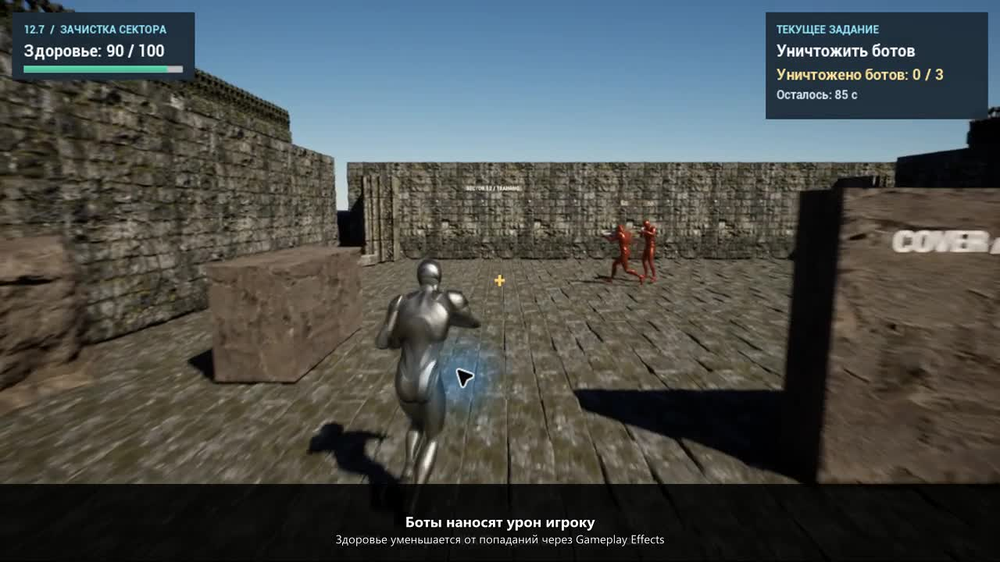
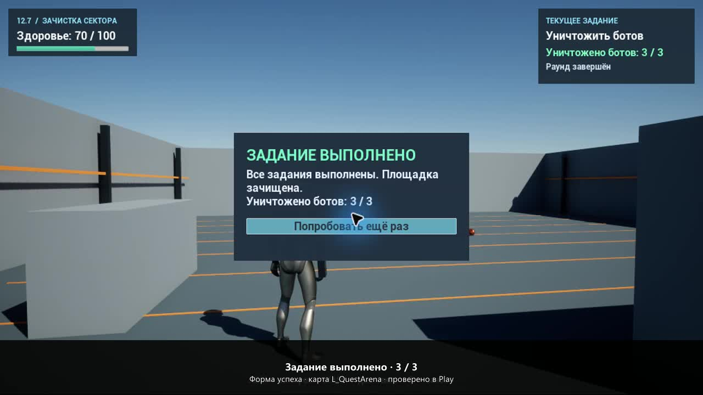
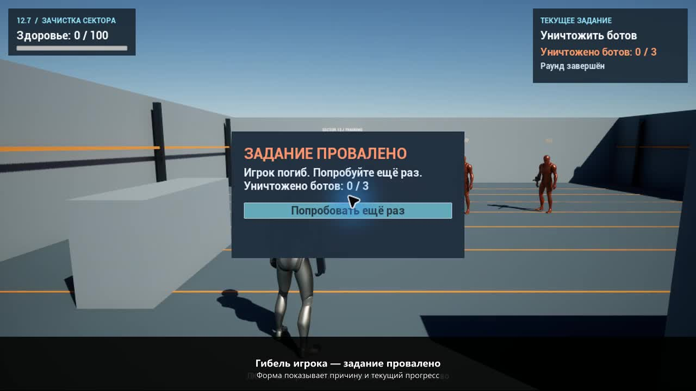

# Практическая 12.7 — квесты, убийства ботов и провал задания

Карта: `/Game/StealthShooter/Maps/L_QuestArena` в основном `StealthShooter.uproject`.

На основе готового боя/GAS из 10.5 добавлены динамический спавн, здоровье и смерть ботов, стрельба игрока и отдельная система квестов. Новые механики находятся в плагине `QuestPractice` и собственной папке ассетов; исходники и карты предыдущих практических не заменяются.

## Обновлённое оформление и движение

В основной карте `L_QuestArena` игрок и боты используют винтовку Epic `SM_Rifle` из установленного First Person Template. Оружие закреплено в правой руке, точка выстрела совпадает со стволом. Сохранённый BlendSpace `BS_QuestRifle` смешивает 17 полнотелых поз: стойку и ходьбу/бег в восьми направлениях. Прыжок использует отдельную позу с оружием и возвращается к обычному движению после приземления.

Боты выбирают достижимые точки патруля на NavMesh, плавно разгоняются и тормозят, поворачиваются с ограниченной скоростью и используют RVO для обхода других персонажей. Урон, кулдаун, здоровье и квестовые правила сохранены.

Локальная карта **`L_QuestArena_Ruins`** добавляет окружение из приобретённой библиотеки Fab: Rock Collection 04 и Abandoned Cathedral. Каменная кладка, плиты, арки, колонны, скалы и обломки образуют тренировочный двор. Декор не меняет коллизии игровой площадки и не перекрывает навигацию.

Исходные Fab-пакеты и локальная карта не публикуются в открытом репозитории. Для их восстановления на компьютере с доступной библиотекой в Python редактора выполнить:

```python
import upgrade_quest_presentation as presentation
presentation.dress_ruins()
```

Папка `Tools` должна быть в Python-пути редактора; путь к локальным исходникам указан в `prepare_catapult_fab.py`. Публичная карта остаётся самодостаточной. [26 проверок оружия, анимации, прыжка, патруля и окружения](QuestPresentationValidation.json) и полный прогон 80 квестовых проверок выполнены в Play на обновлённой локальной карте.

[Обновлённый скринкаст с окружением и оружием — 28 секунд](Screencasts/Practical127_Updated.mp4). Запись настоящего Play: провал от огня ботов, нажатие повтора, шесть попаданий и выполнение 3/3. [Проверка записи](QuestScreencastUpdatedValidation.json).



## Как проверить

1. После клонирования выполнить `git lfs pull`, собрать `StealthShooterEditor` в Unreal Engine 5.8.4. Требуются MSVC v143 14.44, Windows SDK и .NET Framework SDK 4.8, как в 10.5.
2. Открыть `L_QuestArena` и нажать Play. Щёлкнуть по игровому окну для захвата мыши.
3. WASD — движение; мышь — прицеливание; ЛКМ — одиночный выстрел; Space — прыжок; R — новый раунд.
4. Выйти сбоку из-за укрытия и уничтожить **трёх ботов**. Здоровье бота — 50, урон выстрела игрока — 25, поэтому нужны два попадания. Над ботами отображается оставшееся здоровье.
5. Спавнер поддерживает не более двух живых ботов. После смерти освобождается место для нового; тела удаляются через четыре секунды.
6. При достижении 3/3 появляется форма **«ЗАДАНИЕ ВЫПОЛНЕНО»**. Гибель игрока или истечение 90 секунд вызывает **«ЗАДАНИЕ ПРОВАЛЕНО»** с причиной.
7. Нажать **«Попробовать ещё раз»** или R. GameMode удаляет оставшихся ботов, вызывает `RestartPlayer`, сбрасывает счётчик и таймер, затем запускает спавнер. Уровень при этом не перезагружается.

Стартовая карта проекта оставлена прежней. Для этой практической необходимо выбрать `L_QuestArena`.

## Архитектура

| Класс / ассет | Ответственность |
| --- | --- |
| `AQuestObjective` | Общие состояния Inactive / Active / Completed / Failed, запуск, сброс, дедлайн, причина провала и диспетчер изменения. Терминальные состояния нельзя повторно завершить или изменить без сброса. |
| `BP_QuestKillBots` / `AQuestKillBots` | Собственные `RequiredKills` и `CurrentKills`. Учитывает только различных погибших ботов, которых убил игрок, пока квест активен. |
| `BP_QuestDirector` / `AQuestDirector` | Находит и сортирует квесты по Order, управляет очередью и подписками, сообщает об общем результате. Новый тип цели добавляется наследованием от базового класса. |
| `BP_QuestBotSpawner` | Появление ботов по таймеру на NavMesh, настройка класса, области и лимита живых. Подписка на смерть освобождает место; обычное удаление актора не даёт прогресс квеста. |
| `BP_QuestBot` | Наследник прежнего бота: настоящий GAS AttributeSet, здоровье, однократное событие смерти, отключение стрельбы, ragdoll и очистка тела. |
| `GA_QuestShoot` | Проверка живого игрока и активного раунда, GAS commit/cooldown, трассировка прицела и препятствий перед оружием, применение эффекта урона. |
| `GE_QuestDamage` | Instant Gameplay Effect: −25 `CombatAttributeSet.Health` цели. Здоровье ограничивается AttributeSet. |
| `GE_QuestShotCooldown` | Gameplay Effect с тегом кулдауна, 0,35 секунды. |
| `GC_Quest_Shot` | Только вспышка, трассер и звук. Нанесение урона отделено от визуализации. |
| `WBP_QuestHUD` | Здоровье из GAS, текущая цель, счётчик, таймер, общие формы успеха и провала. Изменения здоровья и квестов отслеживаются делегатами. |
| `BP_QuestGameMode` | Запуск и остановка раунда, остановка боя на результате, создание нового игрока через `RestartPlayer`. |

Квесты и менеджер не привязаны к конкретному экземпляру бота. Повторное уведомление о смерти не увеличивает счётчик. Удаление живого бота, чужое убийство и события после окончания задания не засчитываются.

## Файлы

- `Content/StealthShooter/Quests` — новые Blueprint, UMG, Gameplay Abilities / Effects / Cue и материалы.
- `Plugins/QuestPractice/Source/QuestPractice` — базовые классы квестов, спавна, боя и интерфейса с комментариями.
- `Tools/build_quest_practice.py` — создание новой карты и её ассетов.
- `Tools/validate_quest_practice.py` — функциональные сценарии в настоящем Play, включая успех, смерть, тайм-аут и повторный запуск.

Использованы имеющиеся шаблонные ассеты Unreal, собственные материалы и звук предыдущей работы. В `.gitignore` исключены `DerivedDataCache`, `Intermediate`, `Platforms`, `Saved`, `.vs`, `Binaries`; C++-исходники включены в репозиторий.

## Проверки

80 функциональных проверок в Play пройдены без ошибок: здоровье GAS, попадания, урон и кулдаун; собственный счётчик 0/3 → 3/3; защита от повторного зачёта; динамический спавн и лимит; замена удалённых и погибших ботов; завершение, гибель игрока и тайм-аут; формы результата; перезапуск и восстановление здоровья без смены World. [Отчёт](QuestPracticeValidation.json).

Реальными вводами проверены ЛКМ и R. Выстрел в укрытие не наносит урон ботам и не изменяет прогресс. [Проверка ввода](QuestNativeInputValidation.json).

## Скринкаст

[Скринкаст практической 12.7 — MP4, 27 секунд](Screencasts/Practical127.mp4): гибель от огня ботов и форма провала, реальное нажатие кнопки повтора, новый игрок со здоровьем 100 и счётчиком 0/3, шесть попаданий по трём ботам и форма успеха 3/3. Записан настоящий Play с поясняющими подписями; длительная пауза на форме вырезана, скорость игры не изменена. Без звуковой дорожки. [Проверки во время записи](QuestScreencastValidation.json).




