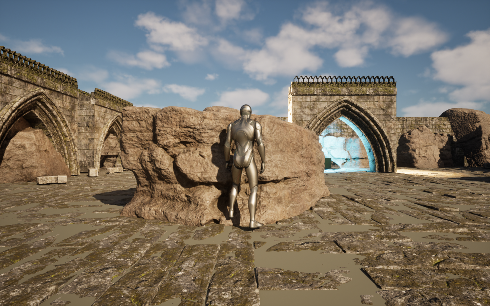
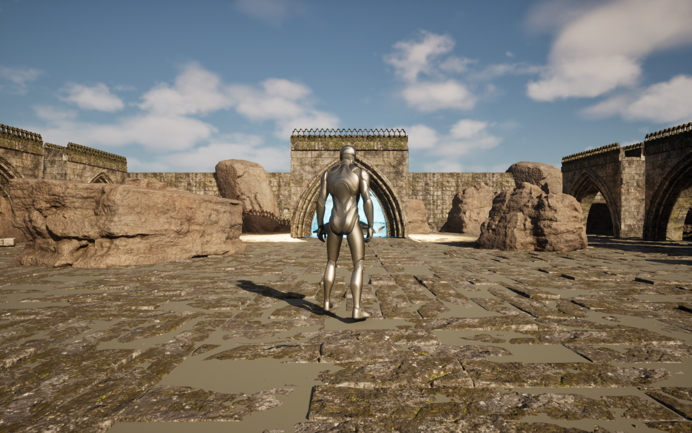

# Практическая 9.6 — Gameplay Ability System

Рефакторинг **предоставленного HW_09** на Gameplay Ability System. Дополнительно исправлен проход рывком сквозь препятствия и создана локальная сцена с ресурсами Fab. Unreal Engine **5.8.4**, Blueprint-проект со штатным **Gameplay Abilities**.

## Запуск

1. Клонируйте репозиторий с Git LFS и выполните `git lfs pull`.
2. Откройте **`Practicals/HW09_GAS/HW_09_GAS.uproject`**, а не корневой `StealthShooter.uproject`.
3. На стартовой карте **ThirdPersonMap** нажмите **Play** и щёлкните внутри игрового окна.
4. **Правая кнопка мыши** — рывок. **WASD** — движение, **мышь** — обзор, **Space** — прыжок, **Esc** — выход из Play.

Сборка C++ и инструменты редактирования проекта не требуются. Для этой работы используется отдельный `.uproject`, поскольку предоставленный HW_09 содержит другие версии одноимённых ThirdPerson-ассетов. Предыдущие карты и практические работы в корневом проекте не изменены.

## Как устроено

| Ассет | Ответственность |
| --- | --- |
| `HW09/Characters/BP_DashCharacterBase` | Общие настройки исходного персонажа, камера, движение, Enhanced Input и AbilitySystemComponent. При BeginPlay выдаёт GA_Dash один раз. |
| `ThirdPerson/Blueprints/BP_ThirdPersonCharacter` | Конкретный наследник базового класса; ссылки исходных GameMode и уровня сохранены. |
| `HW09/Abilities/GA_Dash` | CommitAbility, применение GE_Dash, перемещение вперёд с проверкой всей капсулы, EndAbility. При неудачном Commit или неверном Avatar способность завершается. |
| `HW09/Abilities/GE_Dash` | Instant Gameplay Effect без стоимости и задержки, запускающий GameplayCue.Dash. |
| `HW09/Abilities/Cues/GC_Dash` | OnExecute воспроизводит исходные частицы и звук в точке старта рывка. |
| `Config/DefaultGameplayTags.ini` | Зарегистрированные теги Ability.Dash и GameplayCue.Dash. |

Событие **IA_Dash Started** только запрашивает активацию способности через ASC. Прямой вызов рывка и его эффектов из персонажа удалён. В графах добавлены комментарии; настройки сгруппированы по категориям `Dash|Movement`, `Dash|Presentation`, `Dash|Diagnostics`. `DashCueCount` — диагностический счётчик выполненных Cue, без Tick и влияния на игру.

## Поведение рывка

- В свободном пространстве — мгновенный рывок **300 см вдоль Actor Forward Vector**.
- **Sweep=true**: капсула останавливается перед первым блокирующим препятствием. Дальность 300 см — максимальная; у стены или камня рывок короче. **Teleport=true** сохраняет исходную скорость, но не отключает Sweep.
- Сначала вспышка и звук в точке старта, затем перемещение.
- Частицы **P_ky_hit1**, масштаб **0.6**; звук **VR_teleport_Cue**, громкость **0.5**, pitch **1**.
- Отсутствие стоимости и перезарядки: каждое новое нажатие допускает новый рывок, удержание не повторяет его.
- Персонаж, анимации, камера, карта, прыжок и обычное движение.

## Скринкаст для проверки

[Скачать скринкаст 9.6 — MP4, 19 секунд, со звуком](../../Docs/Screencasts/Practical96.mp4).

Показаны рывок настоящим нажатием ПКМ, исходные частицы и звук, обычное движение, отсутствие повторения при удержании, новое нажатие без добавленного кулдауна, остановка перед камнем и рывок в прыжке. Записан настоящий Play на дополнительной локальной Fab-сцене. Переходы между тремя демонстрационными сценами смонтированы; скорость игры не менялась. Для проверки проекта из GitHub используйте публичную `ThirdPersonMap`, как описано выше.

Повторная проверка перед записью: 32 проверки на исходной карте и 116 на Fab-сцене без ошибок; дополнительно [29 проверок структуры GAS](Docs/DashSubmissionAudit.json) и [9 проверок во время записи](Docs/DashScreencastValidation.json). [Проверка звуковой дорожки](Docs/DashScreencastAudio.json).

## Проверка

Актуальная проверка исправления: **32 проверки на исходной карте** ([отчёт](Docs/DashCollisionValidation.json)) и **116 проверок на локальной сцене Fab** ([отчёт](Docs/DashRuinsValidation.json)), без неудачных проверок.

Проверены свободное движение и рывок в воздухе, остановка перед стеной с зазором для капсулы, положение и масштаб эмиттеров, удержание, пять последовательных нажатий и каждый Gameplay Cue. На Fab-сцене четыре валуна проверены с четырёх сторон, включая повторное нажатие вплотную к поверхности; отдельно проверен свободный проход через арку.

Дополнительно проверено обычное нажатие правой кнопки мыши перед камнем: [результат](Docs/NativeDashCollision.json). Персонаж остановился перед поверхностью вместо полного перемещения внутрь объекта.

Сохранены исторические отчёты сравнения до дополнительного исправления: [исходник — 29 проверок](Docs/DashBaseline.json), [первый перенос на GAS — 31 проверка](Docs/DashGASValidation.json). Исходная заготовка использовала Sweep=false; это поведение впоследствии исправлено по запросу владельца проекта.

Исходные 226 файлов Content сверены по SHA-256: изменён только **BP_ThirdPersonCharacter** для наследования от нового базового класса; остальные 225 файлов исходной сцены и ресурсов сохранены побайтно. Новые GAS-ассеты находятся в папке `Content/HW09`.

Корневая `.gitignore` исключает временные папки всех вложенных проектов: DerivedDataCache, Intermediate, Platforms, Saved, Binaries и состояние IDE. Бинарные ассеты хранятся в Git LFS. [Происхождение ресурсов](NOTICE.md).

## Локальная сцена Fab

Откройте **Content/HW09Local/Maps/L_DashRuins**. На компьютере владельца добавлены каменная кладка, аркады, скальные границы, четыре игровых валуна, обломки кладки и подсвеченный артефакт. Использованы уже установленные **Rock Collection 04** и **Abandoned Cathedral**. Крупные препятствия блокируют капсулу; у арки сохранён настоящий проход. Под декоративным настилом остаётся ровная игровая поверхность.

Исходные пакеты Fab и эта карта остаются локальными и исключены из публичного репозитория. Публичная ThirdPersonMap запускается самостоятельно с исправленным рывком. Такой способ хранения не распространяет исходники лицензированных пакетов через открытый репозиторий; [условия Fab](https://www.fab.com/eula).

Для восстановления оформления из собственной установленной лицензированной копии в редакторе: `style_hw09_ruins.restore(source_content)`, затем `style_hw09_ruins.run()` из папки Tools. Рецепт создаёт только локальную карту, не меняя ThirdPersonMap и предыдущие игры.
