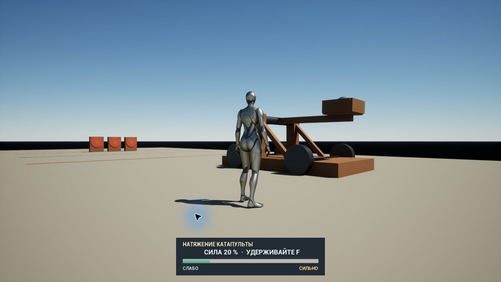
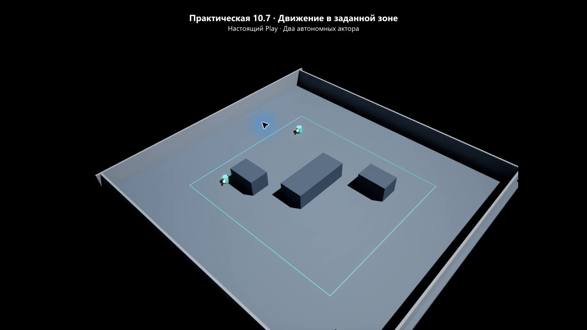
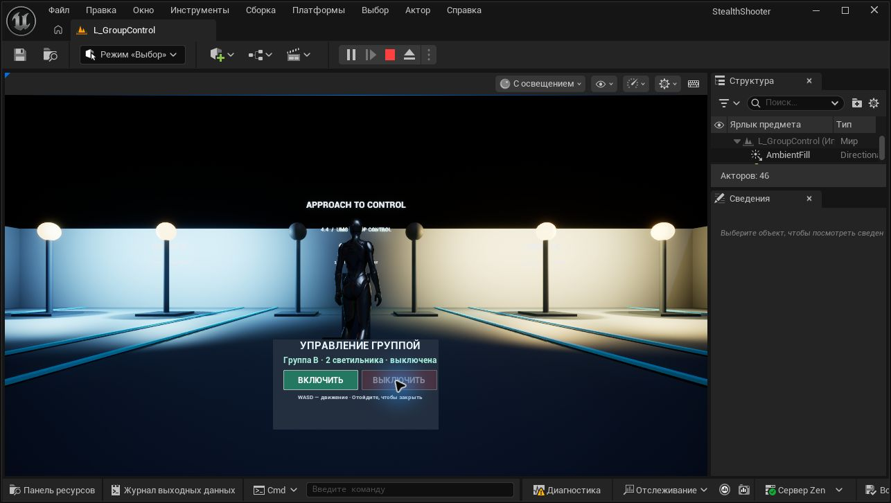
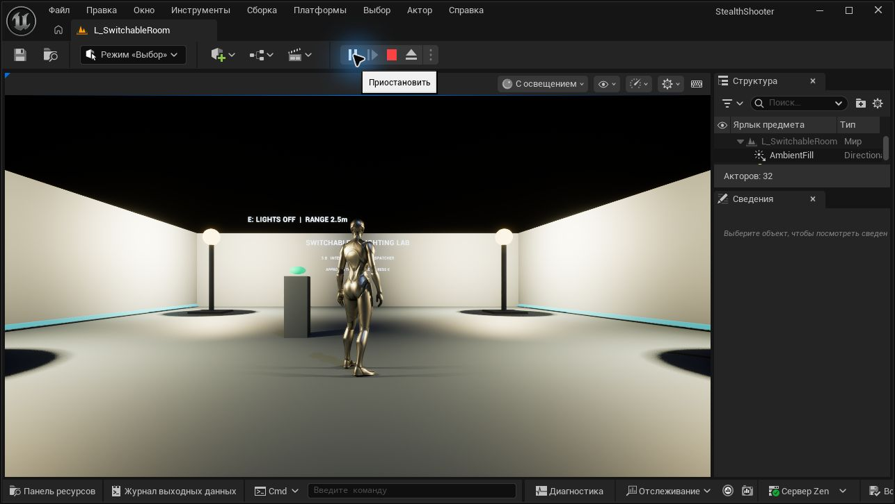
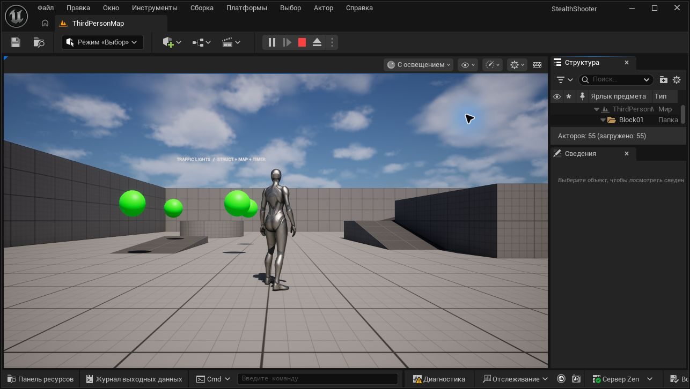

# StealthShooter — продвинутые Blueprint

**Практическая 12.7 — квесты и уничтожение ботов:** [запуск, архитектура и проверки](Docs/Practical127.md). Карта `L_QuestArena`: динамический спавн, здоровье и урон через GAS, счётчик убийств 0/3 → 3/3, формы успеха и провала, респаун и повторный раунд. [Скринкаст, 27 секунд](Docs/Screencasts/Practical127.mp4). Предыдущие игровые карты сохранены.

**Практическая 10.5 — стрельба бота на Gameplay Ability System:** [запуск, устройство и проверки](Docs/Practical105.md). Карта `L_CombatGAS`: AttributeSet здоровья, UMG-полоска, `GA_BotShoot`, Gameplay Cue выстрела, Gameplay Effects урона и кулдауна. Для нативного AttributeSet добавлены C++-модуль и плагин `CombatGAS`; при первом запуске после клонирования необходимо собрать `StealthShooterEditor` (MSVC v143 14.44, Windows SDK, .NET Framework SDK 4.8). Старые карты и проект HW_09_GAS сохранены.

**Практическая 9.6 — рефакторинг рывка на Gameplay Ability System:** [проект HW_09_GAS, запуск и проверки](Practicals/HW09_GAS/README.md). Рывок останавливается перед препятствиями; добавлена локальная сцена с Fab. Откройте `Practicals/HW09_GAS/HW_09_GAS.uproject`; это отдельный предоставленный учебный проект в том же репозитории. Ранее выполненные игровые проекты сохранены.

Учебный проект Unreal Engine 5.8.4 по продвинутым Blueprint и взаимодействию объектов. Практические работы 1.9, 3.8, 4.4, 5.4, 10.7 и 3.10 курса «Стелс-шутер 2.0» находятся в одном проекте.

**Текущая практическая 3.10 — катапульта:** физический шарнир, спавн ядра в ложке, натяжение удержанием **F**, бросок при отпускании и автоматическая перезарядка. Импульс не используется. [Запуск, устройство и проверки](Docs/Practical310.md).

[Шкала силы, обновлённое оформление и локальная сцена с Fab](Docs/CatapultCharge.md).

Уроки **11.3–11.5** сохранены отдельно: [механики лабиринта и проверка в Play](Docs/Lessons113-115.md).

Урок **11.2 «Начало создания игры»**: [схема систем «Лабиринта», ответственность сущностей и порядок реализации](Docs/Lesson112.md). Это подготовительный этап модуля 11; предыдущие игровые ассеты сохранены.

## Запуск

1. Клонируйте репозиторий с установленным Git LFS и выполните `git lfs pull`.
2. Откройте `StealthShooter.uproject` в Unreal Engine 5.8.4.
3. На стартовой карте `L_Catapult` нажмите Play. Щёлкните по игровому окну, **удерживайте F** для выбора силы и **отпустите F** для броска. Шкала внизу показывает заряд от 20% до 100%. Катапульта автоматически вернётся и зарядится снова.
4. Повторите выстрел после завершения перезарядки. Повторные нажатия во время перезарядки игнорируются. **WASD / мышь / Space** — стандартное управление Third Person, **Esc** завершает Play In Editor.

Для практической **10.7** откройте `L_BoundedPatrol`. В экземплярах `BP_BoundedPatrol` доступны `Speed` (см/с), `MinX`, `MaxX`, `MinY`, `MaxY` (мировые координаты).

Практическая **10.7**: стандартные `CharacterMovement`, `AIMoveTo` и NavMesh; случайные достижимые цели, возврат при выходе за границы и обход Static Mesh Actor. Ручного изменения позиции в игровой логике нет. [Устройство и результаты проверки](Docs/Lesson107.md).

Практическая **5.4**: общая папка проекта, тематическая структура, библиотека материалов, булевы `bOn` / `bBound` / `bNearby`, категории, обработчики `On…`, явные Return и комментарии. [Что изменено и как проверено](Docs/Lesson54.md).

Для практической **4.4** откройте `L_GroupControl`, подойдите к пульту и используйте кнопки UMG. Каждый `BP_GroupSwitch` хранит редактируемый в экземпляре массив `SwitchTargets` и управляет им через `BPI_Switchable`. `WBP_GroupSwitch` показывает состояние и проверяет расстояние перед действием. [Требования, настройка и проверки](Docs/Lesson44.md).

Для практической **3.8** откройте карту `L_SwitchableRoom`: подойдите к консоли и нажмите **E** в радиусе 2,5 метра. Она использует **BPI_Switchable**, кнопку **BP_LightSwitch** с диспетчером **OnSwitched** и четыре **BP_SwitchableLamp**, которые подписываются на него самостоятельно. Проверяются расстояние до игрока и корректность ссылок. Подсказка остаётся читаемой при выключенном освещении. [Устройство, требования и проверки](Docs/Lesson38.md).

Для практической 1.9 откройте карту `Content/ThirdPerson/Maps/ThirdPersonMap`: светофоры переключаются Green → Yellow → Red каждые 2 секунды. В экземпляре `BP_TrafficLightsManager` параметр `VariableIntervals` включает дополнительный режим: зелёный 3 секунды, жёлтый 1, красный 5. Меняйте параметры перед запуском Play. `SettingsRow` выбирает строку из `DT_TrafficSettings`, а `ColorSettings` хранит рабочую структуру с Map цветов.

Карта `Content/StealthShooter/Maps/L_BlueprintLab` содержит отдельные демонстрации структур, Array, Set, Map, ForEach, Break, Delay и таймеров. Это основа следующих этапов курса; игровая логика полноценного стелс-шутера пока не реализована.

## Реализовано

- **1.3–1.5:** Make/Break/Set Members структуры, выбор меша из структуры, обход контейнеров и досрочное завершение цикла. [Описание и проверки](Docs/Lessons13-15.md).
- **1.6–1.8:** Enumeration и Switch, Data Table и Row Handle, Delay, Retriggerable Delay, повторяющийся и одноразовый Timer. [Описание](Docs/Lessons16-19.md).
- **1.9:** `BP_TrafficLightsManager.Recolor` читает ColorSettings и вызывает существующий ChangeColor у каждого светофора; таймер повторяет цикл без Tick. Добавлен режим с разными длительностями.
- **3.8:** взаимодействие с кнопкой по E через интерфейс и индивидуальные подписки светильников на диспетчер.
- **4.4:** три независимые группы с массивами объектов в экземплярах пультов; контекстная панель UMG с включением, выключением и отображением состояния.
- **5.4:** структура и оформление проекта взаимодействия приведены к конвенциям модуля 5. [Правила проекта](Docs/ProjectStyle.md).
- **10.7:** автономное движение в заданной зоне через MovementComponent и AIMoveTo, скорость в свойстве Speed, возврат за границы и обход препятствий.

Инструменты редактирования включаются только через `Tools/OpenStealthEditor.ps1 -WithTools`. Для обычного просмотра готовых Blueprint они не нужны. Бинарные ресурсы находятся в Git LFS, временные данные и сборки исключены через `.gitignore`.

Проект использует предоставленную учебную заготовку и ресурсы Third Person от Epic Games. [Происхождение ресурсов](NOTICE.md).
